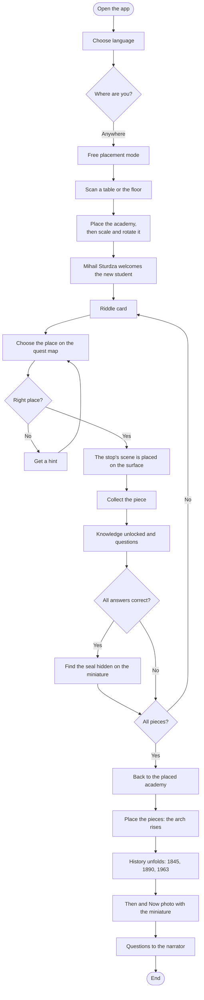
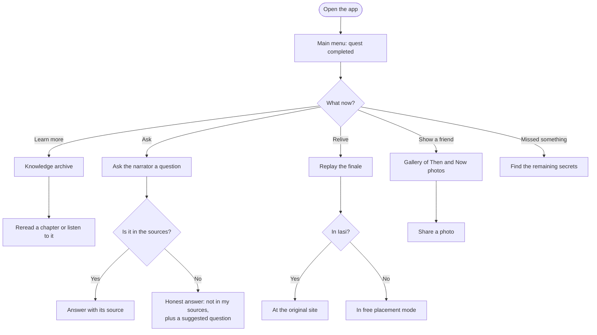

# The Arch of Time

**- An Android AR quest in which you become a student of the lost Academia Mihăileană, the forerunner of UAIC, and search the real streets of Iași for the pieces of its demolished arch, to see the academy rise again where it stood. -**

Team members: _Iacob David-Gabriel_

> This document describes the **ideal version** of the app, with all the planned features, not only what will fit in the first release.

---

## User Story Map

- **User 1: the on-site player.** Florin, a first-year UAIC student who walks past the academy's former site every day without knowing it was there.
  - **Goal:** discover where his university began by rebuilding the lost academy and its arch on the real streets of Iași.
    - **Activity: Start the journey**
      - Mode choice: in Iași or anywhere
      - Language choice: English or Romanian
      - Welcome by Mihail Sturdza, the AI narrator
      - The academy in 1835 at full scale, without the arch
      - Safety note: look up from the phone while walking
    - **Activity: Search for the pieces**
      - Riddle cards
      - Progressive hints, automatic after a while
      - Hot/cold indicator based on GPS distance
      - Quest map with the stops found so far
      - Geospatial scene that locks in near the destination
      - Progress saved after every stop, so the quest can take several days
    - **Activity: Learn at each stop**
      - Arch piece collected in AR
      - Unlocked knowledge, narrated
      - Questions about what he just learned
      - Progress view: pieces, knowledge, secrets
    - **Activity: Find the secrets**
      - Sturdza's clue as a reward for answering all the questions correctly
      - Vibration and a faint seal icon within about 30 m of a secret
      - Wax seal of the academy pinned to a real wall or rooftop, found with the camera
      - Secret card: a rare fact, an old image or a narrated scene
      - Reward for all the seals: Sturdza's letter and a gold Then & Now frame
    - **Activity: Rebuild the arch**
      - Return to the academy's site
      - Place the pieces, the arch rises
      - Time journey: 1845 &rarr; 1890 &rarr; 1963
      - Demolition dissolve and "ghost" academy
      - Emotional ending: the legacy lives on in UAIC
    - **Activity: Keep the memory**
      - Then & Now photo
      - Share the photo
      - Open questions to the narrator
      - Knowledge archive to reread
      - Replay the finale

- **User 2: the remote player.** A history teacher in another city who wants to show her class the origins of the first Romanian university, or anyone who cannot come to Iași.
  - **Goal:** live the same story without being in Iași, on a classroom table or in a park.
    - **Activity: Set up the scene**
      - Free placement mode
      - Surface detection, place the academy
      - Scale and rotate: table size or real size
      - Narrator welcome, same as on site
    - **Activity: Play the quest**
      - Riddles answered on the quest map instead of walking
      - Each stop's scene placed on the table
      - Collect the pieces, knowledge and questions
      - Seals hidden on the miniature scene, for example behind the academy
      - Rebuild the arch and watch history unfold
    - **Activity: Discuss and remember**
      - Open questions to the narrator, with sources
      - Then & Now photo with the miniature academy
      - Knowledge archive for the lesson
      - Replay any chapter

---

## Quest Route

The quest starts and ends at the academy's original site, on Strada Arcu, between Biserica Tălpălarilor and Colegiul Național. The four pieces of the arch are found in the order of the academy's history. The last piece is found at the university, which carries the academy's legacy today, and then the user goes back to the site for the finale.

| Order | Place | Chapter of the story | Piece of the arch |
|---|---|---|---|
| Start | The academy's site, Strada Arcu | Welcome: the academy in 1835, without the arch | - |
| 1 | Trei Ierarhi Monastery | **The beginnings:** the first courses in 1834, the purchase of Casele Cazimir, the opening on 16 June 1835 | Left column |
| 2 | Colegiul Național | **Two buildings, one academy:** the Voinescu houses bought in 1837 for the boarding school; the arch's other foot stood here | Right column |
| 3 | Parcul Expoziției, at the arch replica | **Building the arch:** Asachi's idea, Costinescu's plan with the engineering students, the foundation stone in 1841, the arch finished in 1845 and handed over in 1847 | The arc |
| 4 | UAIC main building | **From academy to university:** the academy's legacy lives on in today's university | The top beam |
| Finale | Back at the academy's site | Place the arch: 1845, 1890, 1963 | All four |

The route is about 7 km long, around 2-2.5 hours with the stops. Progress is saved after every stop, so the quest can be spread over several days, and the narrator can suggest public transport along Bulevardul Carol I for the longer walks.

### Secrets: the seals of the academy

Each secret is a wax seal of the academy, hidden near the route. Finding the seals is optional: they never block the arch.

1. **Earn the clue:** answer all the questions at a stop correctly, and Sturdza gives a one-line clue to a seal nearby.
2. **Get close:** there is no hot/cold indicator for seals. Within about 30 m, the phone vibrates and a faint seal icon appears.
3. **Look around:** the seal is pinned to a real wall or rooftop, so the user has to look around with the camera.
4. **Tap the seal:** the secret card opens with a rare fact, an old image or a narrated scene.

| Where | Secret |
|---|---|
| Biserica Tălpălarilor, at the start | Tutorial seal: an old lithograph of the academy, its neighbor |
| Strada Arcu, near stop 2 | Why the street is called "Arcu": it is named after the arch |
| Parcul Expoziției, stop 3 | The arch was handed over in 1847 without its planned inscriptions and bas-reliefs |
| UAIC, stop 4 | Kogălniceanu's lecture of 24 November 1843, narrated |
| All four seals found | After the finale: a narrated letter from Sturdza to "his student" and a gold Then & Now frame |

The tutorial seal at the start shows how secrets work. Its clue comes with the welcome, not from questions.

In free placement mode, each stop's seal is hidden somewhere on the miniature scene, for example behind the academy.

---

## Journey Maps

There are three usage types: the on-site quest in Iași, the remote quest in free placement mode, and coming back after the quest is finished.

### 1. On-site quest in Iași

```mermaid
flowchart TD
    A([Open the app]) --> B[Choose language]
    B --> C{Where are you?}
    C -->|In Iasi| D[Walk to the academy's original site]
    D --> E[Geospatial localization:<br/>point the phone at the street]
    E --> F[The academy appears as in 1835,<br/>without the arch]
    F --> G[Mihail Sturdza welcomes the new student<br/>and asks for help to build the arch]
    G --> G1[Tutorial seal at Biserica Talpalarilor:<br/>how secrets work]

    G1 --> H[Riddle card for the next stop:<br/>Trei Ierarhi, Colegiul National,<br/>Parcul Expozitiei, UAIC]
    H --> I{Know the place?}
    I -->|No| J[Get a hint] --> I
    I -->|Yes| K[Walk there with the hot/cold indicator]
    K --> L{Close enough?}
    L -->|Colder| K
    L -->|Hot| M[The scene locks in place:<br/>the arch piece glows]

    M --> N[Collect the piece]
    N --> O[Knowledge unlocked, narrated]
    O --> P[Answer the questions]
    P --> Q{All answers correct?}
    Q -->|No| S[Progress view, progress saved]
    Q -->|Yes| R[Sturdza's clue to a seal nearby]
    R --> R1{Look for it now?}
    R1 -->|Later| S
    R1 -->|Yes| R2[Within about 30 m the phone vibrates]
    R2 --> R3[Find the wax seal on a real wall<br/>and tap it: secret unlocked] --> S
    S --> T{All pieces?}
    T -->|No| H
    T -->|Yes| U[Return to the academy's site]

    U --> V[Place the pieces:<br/>the arch rises, 1845]
    V --> W[1890: the arch crumbles to dust]
    W --> X[1963: the academy fades to a ghost]
    X --> Y[The legacy continues in UAIC]
    Y --> Y1{All seals found?}
    Y1 -->|Yes| Y2[Sturdza's letter<br/>and the gold frame] --> Z
    Y1 -->|No| Z[Then and Now photo]
    Z --> AA[Questions to the narrator]
    AA --> AB([End])
```

### 2. Remote quest in free placement mode

### 3. Coming back after the quest

---

## Storyboard

> All the storyboard images below were **drawn by Claude, Anthropic's AI assistant**, with a Python script, following our description of the app. They are abstract sketches of the key moments, not final designs. The files are in [`docs/storyboard/`](storyboard/).

<table>
  <tr>
    <td> <b>1. Welcome, new student.</b> At the original site, the academy appears as in 1835, without the arch, and Mihail Sturdza greets the user.</td>
    <td> <b>2. A riddle.</b> The riddle points to the next stop of the route; the hints get more direct each time.</td>
  </tr>
  <tr>
    <td> <b>3. Hot or cold?</b> While walking, the indicator turns warmer as the user gets closer.</td>
    <td> <b>4. A piece of the arch.</b> Near the destination, the geospatial scene locks in and the piece glows.</td>
  </tr>
  <tr>
    <td> <b>5. Knowledge, questions, progress.</b> A new chapter of the story, a question about it, and the arch filling up.</td>
    <td> <b>6. A secret.</b> After the right answers, the phone vibrates near a seal, and the user finds it on a real wall with the camera.</td>
  </tr>
  <tr>
    <td> <b>7. Rebuilding the arch.</b> Back at the academy, the pieces fly into place and the ensemble is whole, as in 1845.</td>
    <td> <b>8. History unfolds.</b> 1890: the arch crumbles to dust. 1963: the academy fades into a ghost.</td>
  </tr>
  <tr>
    <td> <b>9. Then & Now and questions.</b> A photo with the academy, then open questions answered from the sources.</td>
    <td> <b>10. Playing anywhere.</b> Free placement mode: the same quest on a table, at any scale.</td>
  </tr>
</table>

---

## Planning Asset Creation

**Legend:**
- <ins>underlined</ins> = created from scratch by us
- <mark>highlighted</mark> = generated (3D scan, AI tools)
- plain text with a link = taken from an online source

> The labels in brackets repeat the category, so the list also reads well in GitHub's dark theme, where the highlight is faint. The checkboxes are our checklist: we tick each asset when it is done.

### 3D

- [ ] <mark>**Academia Mihăileană** (AI generated): created from 0 by an AI tool from the 3D scans of the replica maquette, made by **Panagiotis Chontas**, and from our photos of the replica</mark>
- [ ] <mark>**The arch** (AI generated): created by an AI tool from photos of the arch replica in Parcul Expoziției and historical images</mark>
- [ ] <mark>**The arch pieces** (AI generated): the collectible pieces, cut from the AI-generated arch model</mark>
- [ ] <mark>**Mihail Sturdza** (AI generated): 3D model of the narrator, based on his historical portraits</mark>
- [ ] <mark>**Wax seal of the academy** (AI generated): the hidden object that opens a secret, pinned to real walls and rooftops</mark>

No other buildings are modeled: the real city is the scenery, and Streetscape Geometry handles occlusion behind real buildings.

### Graphics & 2D

- [ ] <mark>**UI screens** (AI generated, following our instructions): main menu and mode choice, language choice, welcome, riddle card, hint, knowledge card, questions, secret card, narrator chat, knowledge archive, photo gallery, settings</mark>
- [ ] <mark>**Quest map** (AI generated, following our instructions): an old-map style map of Iași with the stops found so far</mark>
- [ ] <mark>**Progress view** (AI generated, following our instructions): the arch silhouette filling up with the collected pieces, plus knowledge and secrets</mark>
- [ ] <mark>**Hot/cold indicator** (AI generated, following our instructions)</mark>
- [ ] <mark>**Then & Now frame** (AI generated, following our instructions): a lithograph-style photo frame, plus a gold version for finding all the seals</mark>
- [ ] <mark>**Seal icon** (AI generated, following our instructions): the faint icon that appears near a secret</mark>
- [ ] <mark>**App icon** (AI generated, following our instructions)</mark>
- [ ] <mark>**Storyboard images** (AI generated): drawn by Claude for this document</mark>
- [ ] Parchment and old paper textures for the cards: [Pixabay](https://pixabay.com/images/search/old%20paper/) (free license)
- [ ] Lithograph textures for the Then & Now frame and the menus: [Pixabay](https://pixabay.com/images/search/lithograph/) (free license)
- [ ] Period font for titles: [IM Fell English, Google Fonts](https://fonts.google.com/specimen/IM+Fell+English) (Open Font License)
- [ ] Readable font for longer texts: [EB Garamond, Google Fonts](https://fonts.google.com/specimen/EB+Garamond) (Open Font License)
- [ ] Historical images of the academy, the arch and Iași, shown in the knowledge cards and secrets: [Wikimedia Commons](https://commons.wikimedia.org) (each image credited with its author and license)

### Sounds

- [ ] <mark>**Narrator voice** (AI generated, text-to-speech): the guided tour pre-generated as audio files; the live answers spoken with [Android TextToSpeech](https://developer.android.com/reference/android/speech/tts/TextToSpeech)</mark>
- [ ] Period background music, calm 19th-century style, for the welcome and the finale: [Pixabay Music](https://pixabay.com/music/)
- [ ] UI clicks and card sounds: [Freesound](https://freesound.org)
- [ ] Piece pickup chime: [Freesound](https://freesound.org)
- [ ] Hot/cold proximity tick: [Freesound](https://freesound.org)
- [ ] Seal found sound, like wax breaking: [Freesound](https://freesound.org)
- [ ] Stone sounds for the arch assembly: [Freesound](https://freesound.org)
- [ ] Demolition rumble for 1890 and 1963: [Freesound](https://freesound.org)
- [ ] Street ambience of the 1830s-1840s, with horses and carriages: [Freesound](https://freesound.org)

Each Freesound and Pixabay sound will be credited by name and author in the README, as its license requires.

### VFX

- [ ] <mark>**Piece glow** (AI generated shader and particles): the glow and sparkles around a piece waiting to be collected</mark>
- [ ] <mark>**Arch assembly effect** (AI generated shader and particles): the pieces fly into place and the arch rises</mark>
- [ ] <mark>**Demolition dissolve** (AI generated shader and particles): the arch crumbles into dust in 1890</mark>
- [ ] <mark>**Translucent "ghost" shader** (AI generated): the academy fades into an outline in 1963</mark>
- [ ] <mark>**Hot/cold pulse** (AI generated shader): the rings of the indicator pulse and change color with the distance</mark>

### Other assets

- [ ] Historical texts, the knowledge source of the AI narrator and of all the knowledge cards: text from the Faculty of History, Alexandru Ioan Cuza University of Iași
- [ ] Secondary source for checking facts: [Academia Mihăileană, Wikipedia](https://en.wikipedia.org/wiki/Academia_Mih%C4%83ilean%C4%83)
- [ ] 3D scans of the replica maquette, by Panagiotis Chontas
- [ ] <ins>**Riddles, hints, questions and narration scripts** (created by us)</ins>, written from the historical texts, including the seal clues and Sturdza's letter
- [ ] <ins>**Quest route** (created by us)</ins>: the real coordinates of the start and finale on Strada Arcu, the four stops in order (Trei Ierarhi, Colegiul Național, Parcul Expoziției, UAIC main building) and the five seals
- [ ] Link 1: [AR Foundation](https://docs.unity3d.com/6000.0/Documentation/Manual/com.unity.xr.arfoundation.html) (Unity package)
- [ ] Link 2: [ARCore Extensions and Geospatial Creator for Unity](https://developers.google.com/ar/geospatialcreator/unity/quickstart) (Google package)
- [ ] Link 3: [Unity Localization](https://docs.unity3d.com/Packages/com.unity.localization@1.5/manual/index.html) (Unity package)
- [ ] Link 4: AI tools used for the models, images, shaders and voice: [Claude](https://claude.ai) by Anthropic (Claude web for the 3D models and the storyboard images, [Claude Code](https://claude.com/claude-code) for the code, the shaders and part of the Unity Editor work; see [AI usage](AIUsage.md)); _other tools to be added as we use them_
