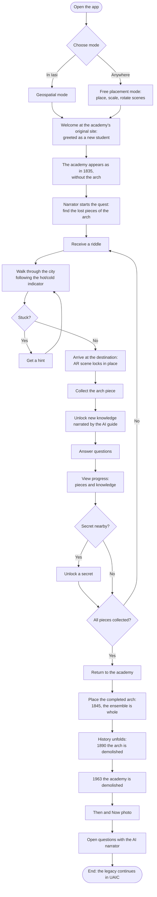

# The Arch of Time

**- An Android AR quest in which you become a student of the lost Academia Mihăileană, the forerunner of UAIC, and search the real streets of Iași for the pieces of its demolished arch, to see the academy rise again where it stood. -**

Team members: _Iacob David-Gabriel_

---

## Description

**(1) Why.**
The Academia Mihăileană, inaugurated in Iași in 1835 and the forerunner of today's Alexandru Ioan Cuza University, no longer exists: the stone arch that connected its two buildings was demolished in 1890, and the main building in 1963. Today there are streets and apartment buildings where it stood, and most people walking by, including UAIC's own students, have never heard of it. Plaques, articles and old photos exist, but they cannot show what the place looked like or make anyone care about it.

**(2) How.**
The Arch of Time turns the history of the academy into a location-based AR quest. The user is welcomed as a new student and sees the academy, at full scale and on its original spot, as it was before the arch existed. Guided by riddles, hints and a hot/cold indicator, they walk through Iași to places linked to the academy's story; at each destination, geospatial AR reveals a scene, a piece of the arch to collect, new knowledge to unlock and a few questions to answer. With all the pieces collected, they return to the academy, place the arch, and watch history unfold: the arch and finally the academy are demolished by time. An AI narrator tells the story and answers questions using only a curated historical knowledge source, so the information stays accurate.

**(3) What is different.**
Most heritage apps let you look at a reconstruction and read about it; The Arch of Time makes you earn it. It combines a city quest (like Pokémon GO) with real, sourced history (like Google Arts & Culture) and places it exactly where the history happened (like MauAR), with an emotional ending in which the user's own work is undone by time. A free placement mode lets anyone play the whole story outside Iași.

---

## Similar products & Relevant Links

**Name:** MauAR - Berlin Wall
**Url:** https://apps.apple.com/app/id1439084007
**Relevant Features**
- Shows a demolished structure (the Berlin Wall) in AR at its original location
- Uses real scale, so users walk alongside it in today's city
- Combines AR reconstruction with historical stories of the place

**Name:** HistoPad (Histovery)
**Url:** https://www.citadellededinant.be/en/histopad
**Relevant Features**
- On-site AR "time travel" through different historical periods of a monument
- Interactive reconstructions of rooms and buildings as they once were
- Treasure-hunt style elements that keep visitors exploring

**Name:** Pokémon GO
**Url:** https://pokemongolive.com
**Relevant Features**
- Location-based gameplay that makes players walk to real places
- Collecting items at real-world points of interest
- Proximity cues that guide players toward nearby targets

**Name:** Google Arts & Culture
**Url:** https://artsandculture.google.com
**Relevant Features**
- Curated, reliable cultural and historical content from institutions
- 3D models and AR views of heritage objects
- Storytelling around places and artefacts

**Name:** ARCore Geospatial API (technology reference)
**Url:** https://developers.googleblog.com/2023/05/build-transformative-augmented-reality-experiences-with-new-arcore-and-geospatial-features.html
**Relevant Features**
- Anchoring virtual content to real-world coordinates in cities
- Streetscape Geometry for occlusion by real buildings
- Rooftop and terrain anchors for correctly placed content

---

## Main Features

**PRINCIPAL MAIN VERY IMPORTANT FEATURE:**
- **The "Rebuild the Arch" geospatial quest:** solve riddles, follow the hot/cold indicator to real places in Iași, collect the pieces of the arch in AR, and finally place the arch at the academy's original location and watch the ensemble's history unfold (1835 &rarr; 1845 &rarr; 1890 &rarr; 1963).

**Other features:**
- **Geospatial reconstruction** of the academy at full scale on its original spot.
- **Free placement mode:** place, scale and rotate the scenes anywhere, so the whole quest can be played outside Iași.
- **Riddles, progressive hints and a hot/cold proximity indicator** guiding the user to each destination.
- **Unlockable knowledge and questions** at each destination, plus hidden secrets along the way.
- **Progress view:** the collected arch pieces and the knowledge unlocked so far.
- **AI narrator** that guides the story and answers questions only from curated historical sources.
- **Time journey finale** with the arch and the academy demolished by time.
- **"Then & Now" photo** with the academy behind you, ready to share.
- **Languages:** English by default, Romanian support. Other languages are planned to be supported.

---

## User Journey Diagram - Step by step flow through app

---

## Moodboard (10+ images)

Visual inspiration for colors, style and atmosphere. Images are stored in [`docs/moodboard/`](moodboard/).

### The academy and its arch
| | | |
|:---:|:---:|:---:|
|  |  |  |
| **Academia Mihăileană** Look of the main building and its dome | **The academy and the arch** How the ensemble looked when it was whole | **Parcul Expoziției** Home of the arch replica |

### Iași then
| | | |
|:---:|:---:|:---:|
|  |  |  |
| **Trei Ierarhi Monastery (1845)** Period atmosphere for the 1835 and 1845 moments | **Iași, the capital of Moldavia** The city as it looked in the academy's time | **Map of Iași** Style of the quest map and progress screens |

### Iași today: the quest landmarks
| | | |
|:---:|:---:|:---:|
|  |  |  |
| **Colegiul Național** On the site of the Voinescu houses | **Biserica Tălpălarilor** Landmark next to the academy's site | **Biserica Sf. Trei Ierarhi** Where the first courses were held in 1834 |

### Characters and visual style
| | | | |
|:---:|:---:|:---:|:---:|
|  |  |  |  |
| **Mihail Sturdza** Look of the narrator | **Lithograph texture** UI panels and the Then & Now photo frame | **Old manuscript** Riddles and unlocked knowledge cards | **Ground indicators** The hot/cold proximity indicator |

---

## Technologies, Libraries, Assets

1. **Unity** - game engine used to build the Android app: https://unity.com
2. **AR Foundation** - Unity's cross-platform AR framework (plane detection, anchors, free placement mode): https://docs.unity3d.com/6000.0/Documentation/Manual/com.unity.xr.arfoundation.html
3. **ARCore Extensions & Geospatial Creator for Unity** - brings Google's ARCore Geospatial features into Unity and lets us place content on real-world map tiles in the editor: https://developers.google.com/ar/geospatialcreator/unity/quickstart
4. **ARCore Geospatial API** - anchors the academy and the quest scenes to real-world coordinates: https://developers.googleblog.com/2023/05/build-transformative-augmented-reality-experiences-with-new-arcore-and-geospatial-features.html
5. **Streetscape Geometry & Rooftop anchors** - occlusion behind real buildings and correct placement: https://developers.google.com/codelabs/arcore-streetscape-geometry-rooftop-anchors
6. **Unity LocationService** - GPS distance for the hot/cold indicator: https://docs.unity3d.com/ScriptReference/LocationService.html
7. **Unity Localization** - English, Romanian and future languages: https://docs.unity3d.com/Packages/com.unity.localization@1.5/manual/index.html
8. **Android TextToSpeech** - free voice for the narrator's live answers: https://developer.android.com/reference/android/speech/tts/TextToSpeech
9. **Blender** - cleaning the scanned academy model and modeling the arch: https://www.blender.org
10. **AI narrator (LLM)** - _service to be decided_, answering only from the curated knowledge source through a small backend that keeps the API key out of the app.
11. **Assets** - 3D scan of the Academia Mihăileană replica maquette; historical texts from the Faculty of History, UAIC.
